<div align="center">

<picture>
  <source media="(prefers-color-scheme: dark)" srcset="src/assets/brand/logo-horizontal-blanco.svg">
  
</picture>

### Rifas y sorteos por enlace y WhatsApp, con pagos verificados y ganadores automáticos

Crea el sorteo, comparte el enlace y deja que Rifa Star aparte los números, cobre, verifique los pagos
y calcule los ganadores con la lotería oficial.

[](https://github.com/Jaider45/RifaStar/actions/workflows/ci.yml)


[Qué es](#-qué-es-rifa-star) ·
[Funciones](#-funciones) ·
[Capturas](#-capturas) ·
[Cómo funciona](#-cómo-funciona) ·
[Stack](#-stack) ·
[Empezar](#-empezar-en-3-pasos) ·
[Estructura](#-estructura-del-repositorio) ·
[Documentación](#-documentación)

</div>

---

## 🎯 Qué es Rifa Star

**Rifa Star** es una plataforma SaaS para organizadores de rifas en Colombia. Cada organización tiene su
propia página pública, su equipo y sus sorteos; los participantes compran desde el celular, sin crear
cuenta, con el enlace que les llega por WhatsApp.

- **Para el organizador:** un panel para crear sorteos en minutos, verificar pagos, anunciar ganadores
  y ver cuánto lleva recaudado, con su equipo y permisos por rol.
- **Para el participante:** elige sus números (o se los asignan al azar), paga en línea o por
  transferencia y recibe su boleto por WhatsApp.
- **Para el equipo de Rifa Star:** un panel de plataforma con organizaciones, planes, facturación,
  plantillas de roles y auditoría.

## ✨ Funciones

<table>
<tr>
<td width="50%" valign="top">

### 🎟️ Sorteos
- Sorteos de **2 a 6 cifras**: de 100 a 1.000.000 de números.
- El participante **elige** sus números o se le asignan **al azar**, con compra mínima.
- Premios por regla: dos últimas, dos primeras, del medio, número completo, **anticipados** y reglas propias.
- **Constructor con vista previa en vivo** y página pública personalizable (colores, tema, redes).
- Edición segura: sin ventas se edita todo; con ventas, solo las fechas.

</td>
<td width="50%" valign="top">

### 💳 Pagos
- **Pago en línea** con tarjeta, Nequi, PSE y Botón Bancolombia, en un checkout propio (Wompi por detrás).
- **Transferencia con comprobante**: cola de verificación con aprobar o rechazar en un clic.
- Apartado **atómico** con tiempo límite: dos personas nunca compran el mismo número.
- Detección de **comprobantes repetidos** y bloqueo del doble cobro.
- **Comprobantes de ingreso** con consecutivo por organización.

</td>
</tr>
<tr>
<td valign="top">

### 🏆 Resultados y ganadores
- Resultados de las loterías vía **LoteríaYa**: el sistema avisa apenas sale el número.
- **Ganadores calculados** automáticamente para cada premio, con números vendidos y no vendidos.
- Pieza lista para estados y grupos, y aviso a los ganadores por WhatsApp.
- Control de **entrega del premio** y resultados públicos.

</td>
<td valign="top">

### 📣 WhatsApp y participantes
- Boletos, confirmaciones, recordatorios y resultados por **WhatsApp Cloud API**.
- **Mis boletos**: el participante consulta sus compras con un código por WhatsApp.
- **Ranking** con puntos por compra, periodos por zona horaria y desempate.
- Enlaces de **vendedor** y de **referido** que viajan con la compra.

</td>
</tr>
<tr>
<td valign="top">

### 👥 Equipo y negocio
- Roles (dueño, administrador, verificador, vendedor) y **roles personalizados** con permisos finos.
- Invitaciones, ventas por vendedor, participantes y exportación CSV.
- **Planes** con límites y periodo de prueba; cobro del plan con tarjeta.
- Dominio propio y marca blanca en los planes superiores.

</td>
<td valign="top">

### 🛡️ Seguridad
- **Aislamiento por organización en dos barreras**: filtro en Prisma y Row Level Security en Postgres.
- **2FA (TOTP) de un solo uso** para quien aprueba pagos o anuncia ganadores.
- Límites de solicitudes, sesiones con refresco rotativo y llaves de pago cifradas.
- **Auditoría inmutable** y modo soporte de solo lectura.
- La API no arranca en producción con valores de desarrollo.

</td>
</tr>
</table>

## 📸 Capturas

### Panel del organizador

<table>
<tr>
<td width="50%">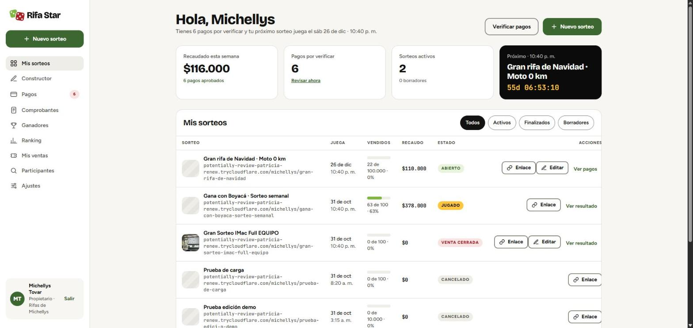</td>
<td width="50%">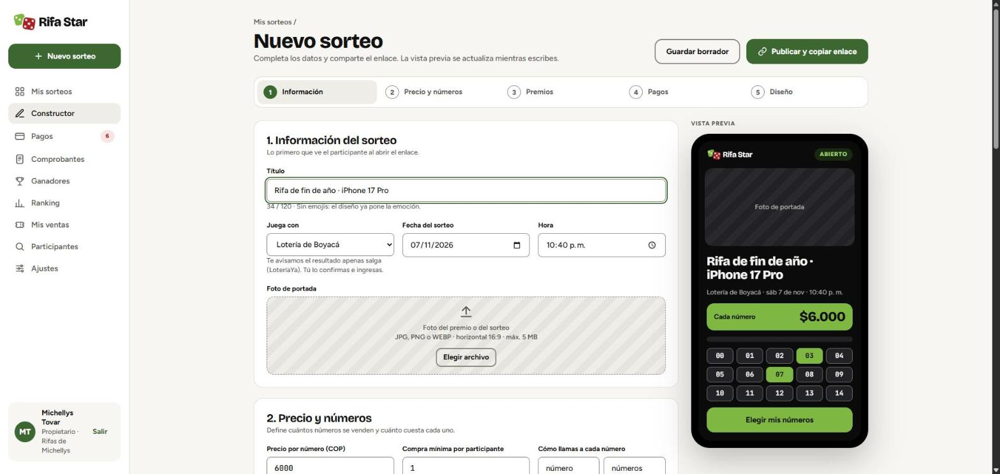</td>
</tr>
<tr>
<td align="center"><b>Mis sorteos</b> · recaudo de la semana, pagos por verificar y próximo sorteo</td>
<td align="center"><b>Constructor</b> · la vista previa se actualiza mientras escribes</td>
</tr>
<tr>
<td>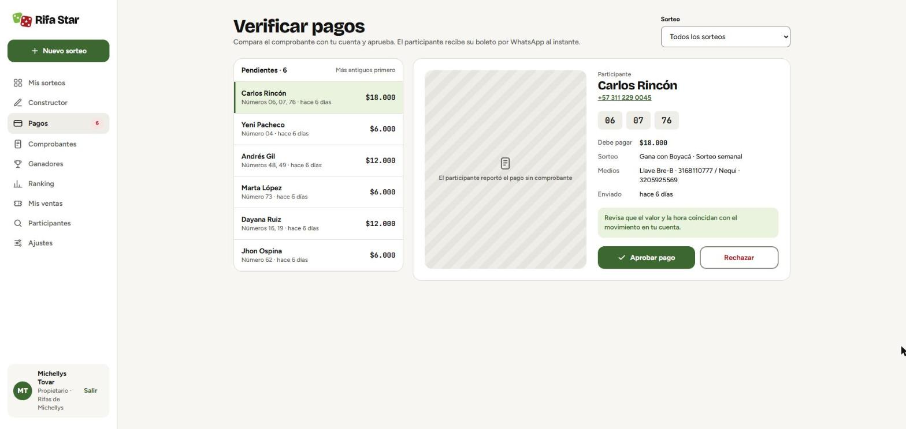</td>
<td>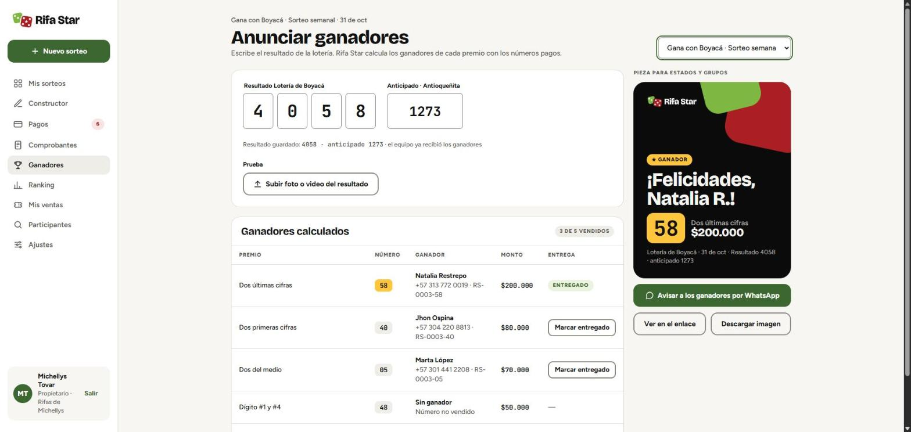</td>
</tr>
<tr>
<td align="center"><b>Verificar pagos</b> · comprobante, valor y medios en una sola vista</td>
<td align="center"><b>Ganadores</b> · calculados con el resultado de la lotería</td>
</tr>
</table>

### Experiencia del participante (celular)

<table>
<tr>
<td align="center" width="25%">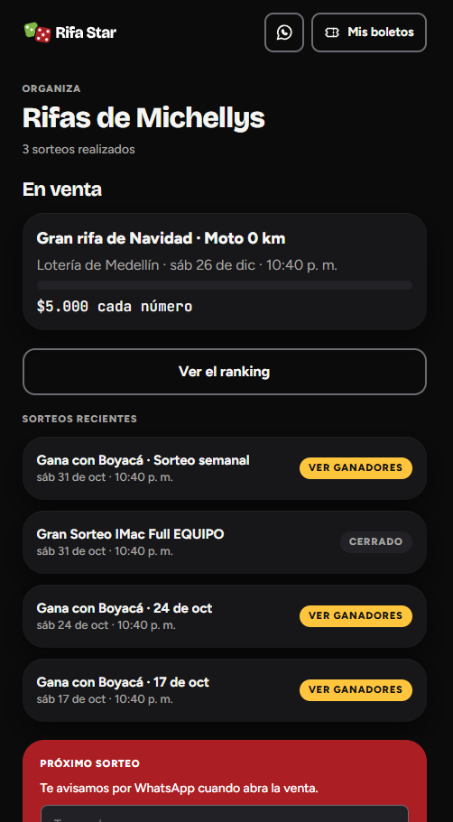</td>
<td align="center" width="25%">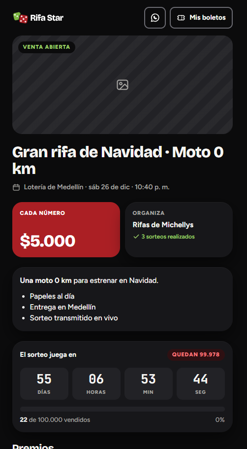</td>
<td align="center" width="25%">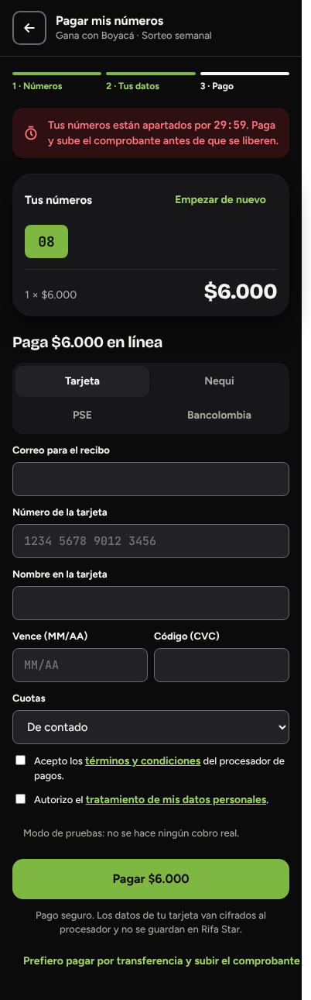</td>
<td align="center" width="25%">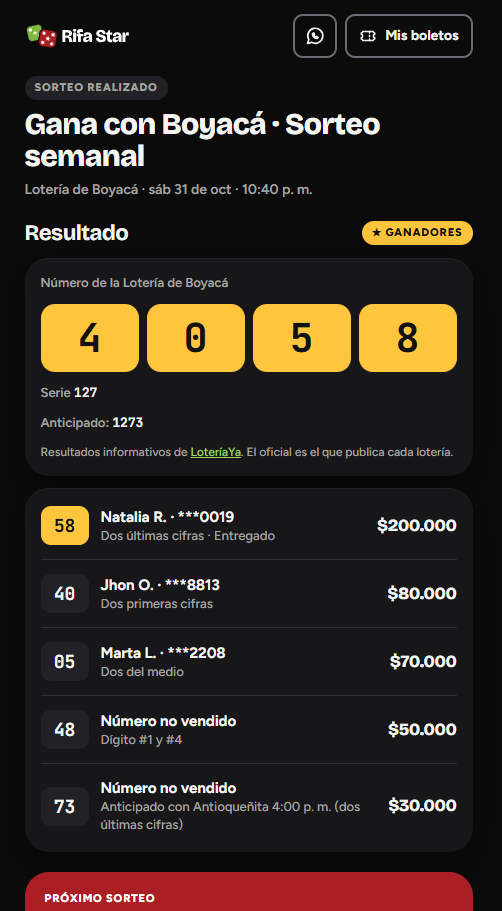</td>
</tr>
<tr>
<td align="center"><b>Organización</b><br>sorteos en venta y recientes</td>
<td align="center"><b>Sorteo</b><br>precio, premios y cuenta regresiva</td>
<td align="center"><b>Pago</b><br>tarjeta, Nequi, PSE o Bancolombia</td>
<td align="center"><b>Resultado</b><br>número ganador y premios</td>
</tr>
</table>

<details>
<summary><b>💳 Más capturas de los pagos en línea</b></summary>
<br>

| Pago aprobado | Tarjeta rechazada | Panel de pagos en línea |
| :---: | :---: | :---: |
| 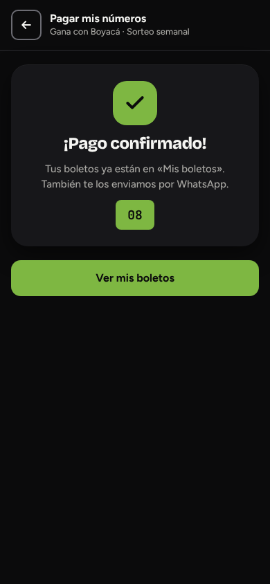 | 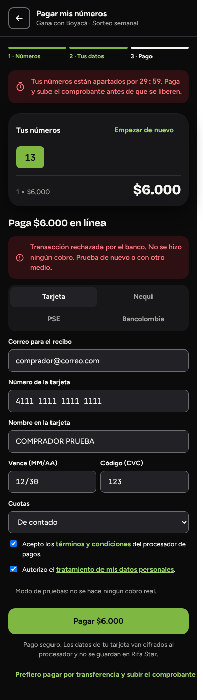 | 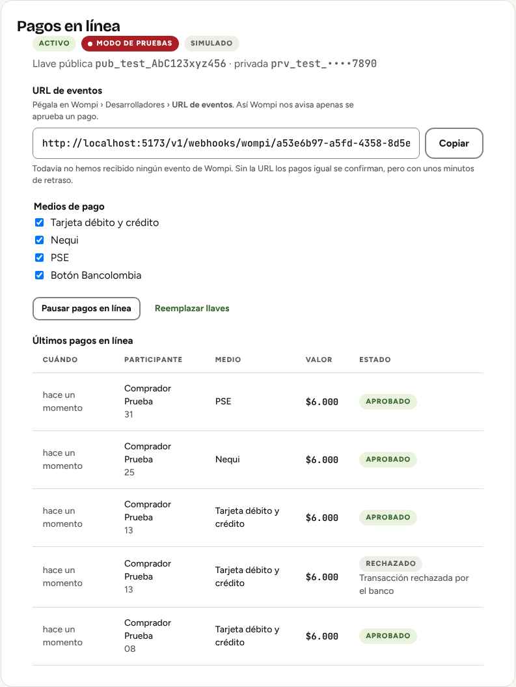 |

| Contratar plan | Plan activo |
| :---: | :---: |
| 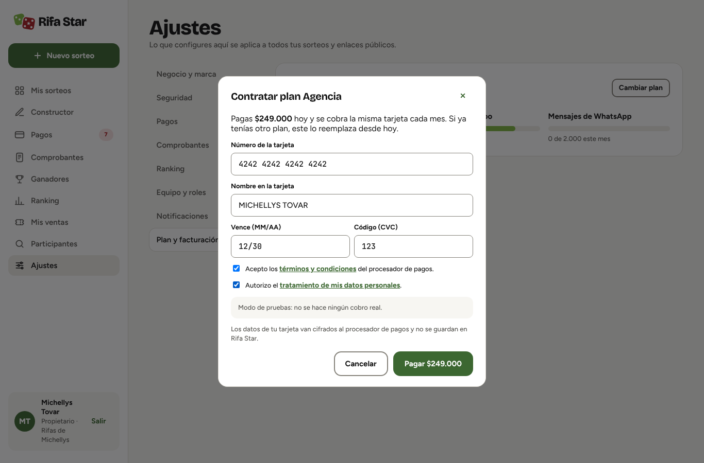 | 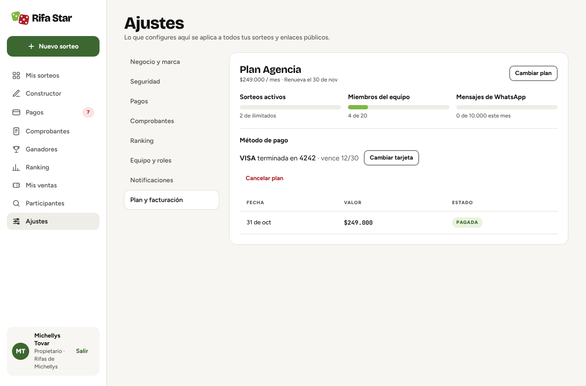 |

</details>

> Las capturas usan los datos de ejemplo del seed: nombres y teléfonos ficticios.

## 🔄 Cómo funciona

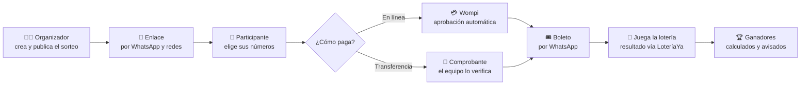

## 🧱 Stack

| Capa | Tecnología |
| --- | --- |
| **WebApp** | React 19 · Vite 8 · TypeScript · TanStack Query · React Router 7 |
| **API** | NestJS 11 · Zod 4 · OpenAPI · Pino |
| **Datos** | PostgreSQL 16 con Row Level Security · Prisma 6 |
| **Colas y caché** | Redis 7 · BullMQ (vencimiento de apartados, mensajes, recordatorios, conciliación) |
| **Archivos** | Almacenamiento S3 (SeaweedFS en desarrollo) con URLs firmadas |
| **Integraciones** | Wompi · WhatsApp Cloud API (Meta) · LoteríaYa · Stripe · SMTP |
| **Calidad** | Vitest · ESLint · GitHub Actions · Dependabot · `npm audit` en 0 |
| **Infraestructura** | Docker Compose · Node 24 LTS · túneles de Cloudflare para demos |

### Arquitectura

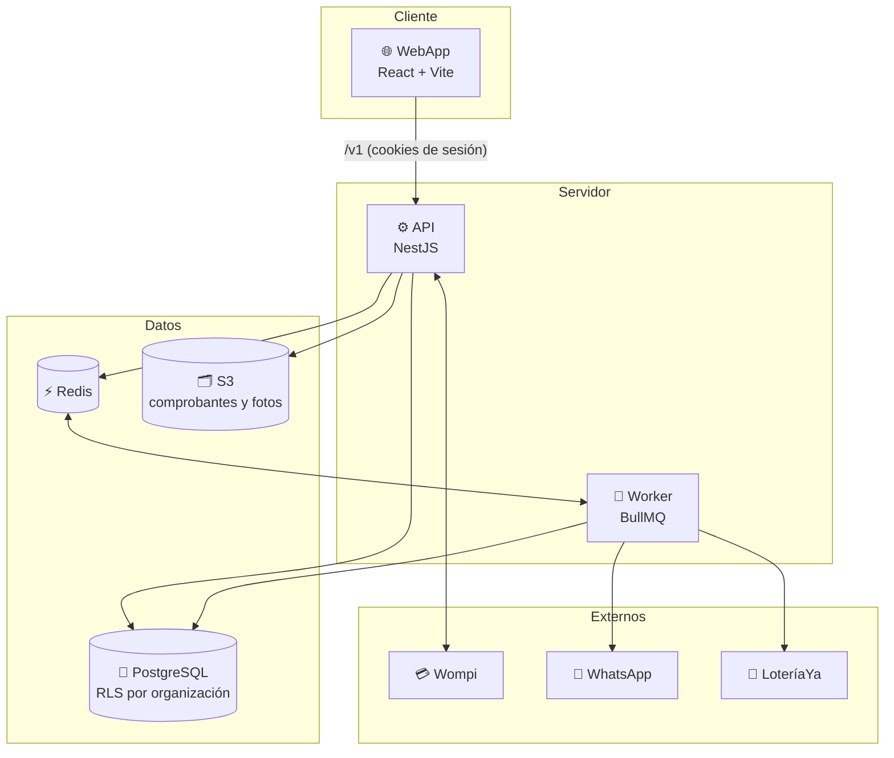

## 🚀 Empezar en 3 pasos

> Requisitos: **Docker** y **Node 24**.

```bash
# 1. API, base de datos, Redis, almacenamiento y correo de pruebas (con datos de ejemplo)
cd api && docker compose up -d --build

# 2. WebApp (desde la raíz, en otra terminal)
npm install
npm run dev
```

**3.** Abre <http://localhost:5173> y entra con un usuario de ejemplo:

| Rol | Correo | Contraseña |
| --- | --- | --- |
| Dueña de «Rifas de Michellys» | `michellys@correo.com` | `clave-segura-123` |
| Equipo de Rifa Star (`/plataforma`) | `admin@rifastar.co` | `RifaStar-dev-2026` |

Los dos piden un código 2FA: agrega el secreto de desarrollo `JBSWY3DPEHPK3PXP` a Google Authenticator
o a cualquier app TOTP. Hay más usuarios en [api/README.md › Usuarios del seed](api/README.md#usuarios-del-seed).
Estas claves son públicas y el seed no las crea en producción.

¿Quieres mostrarlo por internet? `npm run demo` levanta todo con un túnel de Cloudflare y te da una URL
`https://…trycloudflare.com` lista para compartir. Más en la [guía de desarrollo](docs/DESARROLLO.md#demo-por-internet).

## 📁 Estructura del repositorio

```text
RifaStar/
├── src/                     🌐 WebApp (React + Vite)
│   ├── pages/
│   │   ├── admin/           Panel: sorteos, constructor, pagos, ganadores, ranking, ajustes…
│   │   ├── publico/         Página de la organización, sorteo, pago, resultados, mis boletos
│   │   ├── plataforma/      Organizaciones, planes, roles, facturación, actividad
│   │   └── acceso/          Login, registro, invitaciones
│   ├── components/          Componentes compartidos
│   ├── api/                 Cliente HTTP, sesión y hooks de datos
│   └── lib/                 Formatos, fechas, grilla de números, tarjeta (Wompi)
├── api/                     ⚙️ API (NestJS) · ver api/README.md
│   ├── src/
│   │   ├── raffles/         Sorteos, premios, publicar, editar, cancelar
│   │   ├── orders/          Apartado atómico, comprobantes, aprobar y rechazar
│   │   ├── payments/        Pagos en línea con Wompi y cuentas de pago
│   │   ├── results/         Reglas de ganadores y resultados
│   │   ├── messaging/       WhatsApp, notificaciones y cuotas
│   │   ├── receipts/        Comprobantes de ingreso
│   │   ├── ranking/         Puntos, periodos y desempate
│   │   ├── platform/        Panel de la plataforma
│   │   ├── auth/            Sesiones, 2FA y permisos
│   │   └── jobs/            Worker y procesos en segundo plano
│   ├── prisma/              Esquema, migraciones (con RLS) y seed
│   ├── test/                230+ pruebas de integración contra Postgres y Redis reales
│   └── docker-compose.yml   Entorno completo de desarrollo
├── docs/
│   ├── DESARROLLO.md        Guía de desarrollo y mantenimiento
│   ├── backend/PROPUESTA.md Decisiones de diseño
│   └── capturas/            Capturas de este README
├── scripts/demo.mjs         Demo por internet en un comando
└── .github/                 CI, Dependabot y plantilla de pull request
```

## ✅ Calidad

- **CI en cada pull request:** lint sin advertencias, tipos, pruebas de la API y de la web, build,
  contrato OpenAPI al día y `npm audit` sin vulnerabilidades.
- **Pruebas de la API contra servicios reales:** Postgres con RLS y Redis, incluido el recorrido completo
  de un sorteo (publicar → comprar → verificar → resultado → entregar el premio), los pagos en línea y
  el aislamiento entre organizaciones.
- **Dependencias al día** con Dependabot, agrupadas para que no rompan el build.

```bash
npm run lint && npm test && npm run build   # WebApp
cd api && npm run lint && npm test          # API (necesita Postgres y Redis de Docker)
```

## 📚 Documentación

| Documento | Contenido |
| --- | --- |
| [docs/DESARROLLO.md](docs/DESARROLLO.md) | Desarrollo local, demo, rutas, comprobaciones y manejo de dependencias |
| [api/README.md](api/README.md) | Variables de entorno, arquitectura, aislamiento, procesos en segundo plano e integraciones |
| [api/openapi.json](api/openapi.json) | Contrato de la API (Swagger en `/v1/docs` en desarrollo) |
| [docs/backend/PROPUESTA.md](docs/backend/PROPUESTA.md) | Diseño aprobado y decisiones de arquitectura |

---

<div align="center">

Hecho en Colombia 🇨🇴 por **Jaider Riascos** · © 2026 Rifa Star · Todos los derechos reservados

</div>
