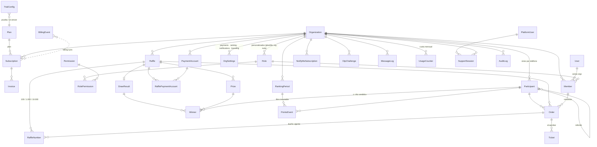

# Rifa Star · API

Backend de **Rifa Star**, un SaaS multi-organización para crear y vender sorteos
por enlace público y WhatsApp.

- **Stack:** Node 20 + TypeScript (strict), NestJS 11, PostgreSQL 16 + Prisma 6
  (con RLS), Redis + BullMQ, almacenamiento S3 (SeaweedFS en desarrollo, Cloudflare R2 en producción),
  WhatsApp Cloud API, LoteríaYa (resultados informativos) y Stripe.
- **Procesos:** `api` (HTTP) y `worker` (colas y tareas programadas). Comparten el mismo código.
- **Idioma:** el dominio y los mensajes van en español; el código, en inglés.
- **Diseño aprobado:** [`docs/backend/PROPUESTA.md`](../docs/backend/PROPUESTA.md), con las decisiones P1–P12.

---

## 1. Levantar con Docker

```bash
cd api
docker compose up -d --build
```

| Servicio | URL |
|---|---|
| API | http://localhost:3000/v1 |
| Documentación (Swagger) | http://localhost:3000/v1/docs |
| OpenAPI (JSON) | http://localhost:3000/v1/openapi.json |
| Mailpit (correos de invitación y contraseña) | http://localhost:8025 |
| Almacenamiento S3 (SeaweedFS: comprobantes, portadas, fotos) | http://localhost:9000 (`rifastar` / `rifastar-secret`) |

Qué hace Compose:

1. `postgres` crea los roles de base de datos (`docker/postgres/01-roles.sql`).
2. `migrate` aplica las migraciones y siembra los datos de ejemplo (§9).
3. `api` y `worker` arrancan.
4. `s3-setup` crea el bucket privado en SeaweedFS (MinIO dejó de publicar imágenes de Docker).

Los archivos se suben directo del navegador con una **URL firmada PUT**: el tipo y el tamaño
exactos van dentro de la firma, y la API valida después el tipo real del archivo. PUT funciona igual
en SeaweedFS, Amazon S3 y Cloudflare R2 (R2 no acepta el formulario POST firmado).

Para volver a empezar de cero:

```bash
docker compose down -v && docker compose up -d --build
```

### Usuarios del seed

| Dónde | Usuario | Contraseña |
|---|---|---|
| Plataforma (`super_admin`, 2FA) | `admin@rifastar.co` | `RifaStar-dev-2026` |
| Rifas de Michellys · owner | `michellys@correo.com` | `clave-segura-123` |
| · admin | `jose@correo.com` | `clave-segura-123` |
| · verificadora de pagos | `karen@correo.com` | `clave-segura-123` |
| · vendedor (código `LUIS`) | `luis@correo.com` | `clave-segura-123` |
| Moto Ya (en prueba) · owner | `felipe@correo.com` | `clave-segura-123` |

**2FA:** el secreto TOTP de desarrollo es `JBSWY3DPEHPK3PXP` para la plataforma **y para los gestores**
(owner, admin y verificadora; el vendedor no lo necesita). Agrégalo a Google Authenticator o a cualquier
app TOTP para generar los códigos. Quien aprueba pagos, anuncia ganadores o maneja el equipo debe tener
el 2FA activo, y el resultado de un sorteo se confirma con un código en el momento.

**Contenido del seed:**

- **Rifas de Michellys** (plan Pro):
  - sorteo activo «Gana con Boyacá · Sorteo semanal»: 2 cifras, $6.000 por número, Lotería de Boyacá el próximo sábado a las 10:40 p. m.;
  - 62 números pagados y 7 pagos por verificar;
  - dos sorteos anteriores ya jugados, con ganadores;
  - llave Bre-B 3168110777 a nombre de José Rodríguez;
  - ranking del mes con 20 participantes;
  - «Gran rifa de Navidad»: **5 cifras** (100.000 números) con la Lotería de Medellín + última cifra de la
    serie, números **siempre al azar**, compra mínima de 2 por participante y página personalizada.
- **Moto Ya** (en prueba): incluye un participante con el mismo teléfono que Laura en Michellys, para probar el aislamiento entre organizaciones.

---

## 2. Desarrollo sin Docker

Requisitos: Node 20+, PostgreSQL 16 y Redis 7.

```bash
cd api
npm install
cp .env.example .env

# Roles de BD (una vez, como superusuario):
psql -U postgres -f docker/postgres/01-roles.sql
createdb -O rifastar rifastar   # el dueño «rifastar» debe existir

npm run db:migrate      # prisma migrate deploy
npm run db:seed         # datos de ejemplo (idempotente)
npm run dev             # API con recarga
npm run dev:worker      # worker (BullMQ)
```

Para correr sin almacenamiento S3 ni SMTP, usa `STORAGE_DRIVER=fake`, `MAIL_DRIVER=fake`,
`MESSAGING_DRIVER=fake`, `LOTTERY_DRIVER=fake` y `BILLING_DRIVER=fake` en `.env`.

`npm run db:reset` borra la base, migra y vuelve a sembrar. Úsalo solo en desarrollo.

---

## 3. Tests

```bash
npm test          # Vitest + Supertest contra Postgres y Redis reales
npm run lint
npm run typecheck
```

Los tests usan la base `rifastar_test` (se recrea al empezar) y Redis en la
base 15. Hay 188 tests en 24 archivos. Los obligatorios del documento están en:

| Requisito | Archivo |
|---|---|
| 50 solicitudes simultáneas por el mismo número → solo 1 gana | `test/reservation.spec.ts` |
| Cada regla de ganador (2, 3 y 4 cifras, ceros a la izquierda) | `test/winner-rules.spec.ts`, `test/results.spec.ts` |
| Rollover del ranking en el cambio de mes con zona horaria (Bogotá y Madrid con DST) | `test/ranking-periods.spec.ts`, `test/ranking.spec.ts` |
| Desempate (llegó primero / más sorteos) | `test/ranking.spec.ts` |
| Aislamiento entre organizaciones (API, filtro de Prisma y RLS) | `test/isolation.spec.ts` |
| Permisos por rol (matriz de la plantilla) | `test/permissions.spec.ts` |
| Límites del plan (402) | `test/plan-limits.spec.ts` |
| 5 y 6 cifras, selección al azar, compra mínima por participante | `test/big-raffles.spec.ts` |
| Resultados de LoteríaYa y avisos a los gestores (WhatsApp y correo, recordatorio) | `test/lottery-alerts.spec.ts` |
| Seguridad: 2FA obligatorio, equipos nuevos, sesiones, separación de funciones, antifraude, antibots | `test/security.spec.ts` |
| Personalización de la página pública y vista previa al compartir | `test/public-page.spec.ts` |

---

## 4. Variables de entorno

La API valida todas al arrancar (`src/config/env.ts`) y se detiene si falta alguna.

| Variable | Por defecto | Descripción |
|---|---|---|
| `NODE_ENV` | `development` | `development` · `test` · `production` |
| `PORT` | `3000` | Puerto HTTP |
| `CORS_ORIGINS` | `http://localhost:5173` | Orígenes permitidos, separados por coma |
| `PUBLIC_BASE_URL` | `http://localhost:5173` | Base de los enlaces públicos e invitaciones |
| `LOG_LEVEL` | `info` | Nivel de pino |
| `DATABASE_URL` | — | Dueño del esquema; solo para el CLI de Prisma (migraciones) |
| `APP_DATABASE_URL` | — | Rol `rifastar_app` (**sin** BYPASSRLS): toda la API del tenant |
| `SYSTEM_DATABASE_URL` | — | Rol `rifastar_system` (BYPASSRLS): plataforma, auth, jobs |
| `REDIS_URL` | `redis://localhost:6379` | Colas, rate limiting |
| `JWT_ACCESS_SECRET` | — | ≥ 32 caracteres. Access token (15 min) |
| `JWT_PARTICIPANT_SECRET` | — | ≥ 32 caracteres. Token de «Mis boletos» (30 min) |
| `ENCRYPTION_KEY` | — | 32 bytes en base64 (`openssl rand -base64 32`). Cifra los secretos TOTP |
| `HASH_PEPPER` | — | Pepper de los hashes de OTP, invitaciones y tokens |
| `ACCESS_TOKEN_TTL_SECONDS` | `900` | Vida del access token |
| `REFRESH_TOKEN_TTL_DAYS` | `30` | Vida del refresh token (cookie httpOnly) |
| `COOKIE_SECURE` | `true` | `false` solo en desarrollo sin HTTPS |
| `STORAGE_DRIVER` | `s3` | `s3` · `fake` |
| `S3_ENDPOINT` / `S3_PUBLIC_ENDPOINT` | — | Endpoint interno y el que ve el navegador (en Docker difieren) |
| `S3_REGION` / `S3_BUCKET` | `us-east-1` / `rifastar` | |
| `S3_ACCESS_KEY` / `S3_SECRET_KEY` | — | |
| `S3_FORCE_PATH_STYLE` | `false` | `true` con SeaweedFS |
| `MAIL_DRIVER` | `smtp` | `smtp` · `fake` |
| `SMTP_URL` / `MAIL_FROM` | `smtp://localhost:1025` | Correo de invitaciones y contraseña |
| `MESSAGING_DRIVER` | `fake` | `meta` (WhatsApp Cloud API) · `fake` |
| `WHATSAPP_PHONE_NUMBER_ID` / `WHATSAPP_ACCESS_TOKEN` | — | Credenciales de Meta |
| `WHATSAPP_APP_SECRET` | — | Verifica `X-Hub-Signature-256` del webhook |
| `WHATSAPP_VERIFY_TOKEN` | — | Alta del webhook (GET) |
| `WHATSAPP_API_VERSION` | `v21.0` | |
| `MESSAGES_RETRY_BASE_MS` | `30000` | Base del reintento exponencial de `send-whatsapp` |
| `LOTTERY_DRIVER` | `fake` | `loteriaya` · `fake` (catálogo fijo, sin consultas) |
| `LOTERIAYA_BASE_URL` | `https://www.loteriaya.com.co/v1` | |
| `LOTERIAYA_API_KEY` | — | Clave de LoteríaYa (cabecera `X-Api-Key`) |
| `LOTERIAYA_WEBHOOK_SECRET` | — | Secreto HMAC-SHA256 de los webhooks de LoteríaYa |
| `LOTERIAYA_SIGNATURE_HEADER` | `x-loteriaya-signature` | Cabecera de la firma: confírmala con la especificación que envía LoteríaYa |
| `BILLING_DRIVER` | `fake` | `stripe` · `fake` (sin llamadas salientes, misma verificación de firma) |
| `STRIPE_SECRET_KEY` / `STRIPE_WEBHOOK_SECRET` | — | |

---

## 5. Arquitectura

```
src/
  auth/          login de org (2FA opcional) y de plataforma (TOTP obligatorio), refresh rotativo
  permissions/   catálogo de claves, @RequirePermission, OrgGuard, PlatformGuard
  plans/         PlanPolicyService + PlanGuard (@RequireFeature) → 402
  tenancy/       aprovisionamiento de organizaciones
  database/      DatabaseService: tenantTx() (filtro por organización + RLS) y cliente de sistema
  organizations/ perfil, equipo, invitaciones, roles personalizados
  settings/      ajustes por sección, versionados con zod
  raffles/       sorteos, premios, publicar, cerrar, cancelar, duplicar
  orders/        apartado atómico, comprobantes, aprobar, rechazar, liberar, hooks
  participants/  lista, detalle, CSV
  results/       winner-rules.ts (módulo puro) + resultados y ganadores
  ranking/       periodos por zona horaria, libro de puntos, desempate, rollover
  messaging/     MessagingProvider (Meta / fake), cola send-whatsapp, notificaciones, webhook
  my-tickets/    «Mis boletos» con OTP
  billing/       BillingProvider (Stripe / fake), webhooks, billing-sync
  platform/      organizaciones, soporte, planes, plantilla de roles, equipo, facturación, actividad
  public/        endpoints sin sesión
  jobs/          colas BullMQ, mantenimiento y worker
```

### Aislamiento por organización (dos barreras)

1. **Prisma:** `tenantTx(orgId, fn)` aplica una extensión que agrega
   `organizationId` a toda consulta sobre un modelo del tenant y rechaza
   escrituras con otro `organizationId`.
2. **Postgres (RLS):** la misma transacción hace `set_config('app.org_id', …)`.
   Las políticas de cada tabla del tenant filtran por `app_current_org()`. El
   rol de la API (`rifastar_app`) no tiene BYPASSRLS. El cliente de sistema
   (`rifastar_system`) solo se usa en plataforma, auth, resolución pública de
   la org y jobs; una regla de ESLint lo impide en el resto del código.

`test/isolation.spec.ts` prueba ambas barreras por separado.

### Reglas críticas

- **Apartado atómico:** CTE `MATERIALIZED` con `FOR UPDATE` en orden de número
  y un único `UPDATE … WHERE status = 'available'`. Si no se actualizan
  exactamente N filas, la transacción se revierte y la API responde
  `409 NUMBERS_TAKEN` con los números tomados.
- **Libros inmutables:** `points_events` y `audit_logs` tienen triggers que
  rechazan `UPDATE`, `DELETE` y `TRUNCATE`.
- **Entrar como soporte:** genera un token `typ=support` de solo lectura (solo
  `GET`) con vencimiento. Cada request queda auditada.
  - Respuestas al agente: cabecera `X-Support-Session`.
  - Respuestas al organizador mientras dure la sesión: cabecera `X-Support-Active`.
  - En todas las respuestas del panel va `X-Account-Status` (`trial`, `active`, `past_due` o `suspended`).

### Procesos en segundo plano (BullMQ, todos idempotentes)

| Job | Disparo | Idempotencia |
|---|---|---|
| `expire-reservations` | cada minuto | `UPDATE … WHERE status = 'reserved' AND reserved_until < now()` + `SKIP LOCKED` |
| `close-sales` | diferido a `sales_close_at` (+ barrido cada minuto) | solo cierra `active`/`sold_out` vencidos |
| `draw-reminder` | diferido a `draw_at − 2 h` | jobId con la fecha + clave por participante en `MessageLog` |
| `ranking-rollover` | cada minuto | índice único «un periodo abierto por org» |
| `send-whatsapp` | por evento; 6 intentos con backoff exponencial | `MessageLog.idempotency_key` + cuota atómica en `usage_counters` |
| `daily-digest` | cada 15 min; envía a las 8:00 p. m. locales | `job_runs (daily-digest, org:fecha)` |
| `billing-sync` | por webhook + barrido cada hora | `billing_events.processed_at` |

### Errores

Todas las respuestas de error tienen la forma `{ code, message, details? }`,
con `message` en español y listo para mostrar al usuario. Los códigos más
comunes son:

- **Validación y sesión:** `VALIDATION_ERROR`, `AUTH_REQUIRED`, `AUTH_2FA_REQUIRED`.
- **Permisos:** `FORBIDDEN_PERMISSION`, `SUPPORT_READ_ONLY`, `ORG_SUSPENDED`.
- **Sorteos y órdenes:** `NUMBERS_TAKEN`, `NOT_ENOUGH_NUMBERS`, `RAFFLE_NOT_ON_SALE`, `ORDER_EXPIRED`.
- **Comprobantes:** `RECEIPT_INVALID_TYPE`, `RECEIPT_TOO_LARGE`.
- **Mis boletos:** `OTP_INVALID`, `OTP_LOCKED`.
- **Equipo, ajustes y límites:** `LAST_OWNER`, `REVISION_CONFLICT`, `RATE_LIMITED`.
- **Plan (402):** `PLAN_LIMIT_ACTIVE_RAFFLES`, `PLAN_LIMIT_MEMBERS`, `PLAN_QUOTA_WHATSAPP`, `PLAN_FEATURE_*` y `PLAN_TRIAL_EXPIRED`.

---

## 6. Diagrama de entidades



El esquema completo, con índices y restricciones, está en
[`prisma/schema.prisma`](prisma/schema.prisma). Lo que Prisma no expresa
(RLS, CHECKs, índices parciales, exclusión de periodos solapados y triggers)
está en `prisma/migrations/*_tenancy_rls`.

---

## 7. Colección de la API (OpenAPI)

- La documentación interactiva vive en `/v1/docs`.
- El archivo [`openapi.json`](openapi.json) se puede importar en Postman,
  Insomnia o Bruno. Para regenerarlo: `npm run openapi`.

| Grupo | Prefijo | Sesión |
|---|---|---|
| Autenticación de organización | `/v1/auth`, `/v1/invitations` | — / Bearer |
| Panel de la organización | `/v1/raffles`, `/v1/orders`, `/v1/payments`, `/v1/participants`, `/v1/ranking`, `/v1/settings`, `/v1/team`, `/v1/roles`, `/v1/billing`, `/v1/dashboard`… | Bearer + `X-Organization-Id` |
| Público | `/v1/public/…` | sin sesión (rate limit) · token de orden · token de participante |
| Plataforma | `/v1/platform/…` | Bearer de plataforma (después del TOTP) |
| Webhooks | `/v1/webhooks/whatsapp`, `/v1/webhooks/billing/stripe` | firma |

---

## 8. Integraciones

### WhatsApp Cloud API (Meta)

Crea estas plantillas en Meta (categoría *utility*, idioma `es`). Los
parámetros van en el orden indicado:

| Plantilla | Parámetros |
|---|---|
| `rs_otp_code` | código, organización |
| `rs_ticket_confirmed` | nombre, sorteo, números, boletos, fecha del sorteo |
| `rs_payment_rejected` | nombre, sorteo, motivo |
| `rs_raffle_cancelled` | nombre, sorteo, motivo |
| `rs_winner_notice` | nombre, sorteo, número, premio |
| `rs_draw_reminder` | nombre, sorteo, hora, números |
| `rs_new_raffle` | nombre, organización, sorteo, enlace |
| `rs_ranking_top10` | organización, periodo, top |
| `rs_daily_digest` | organización, fecha, recaudo, aprobados, por verificar |

Para recibir los estados de entrega:

1. Configura el webhook en `https://TU-API/v1/webhooks/whatsapp` con `WHATSAPP_VERIFY_TOKEN`.
2. Suscríbelo al campo `messages`.

### Stripe

1. Crea un precio mensual por plan.
2. Guarda su id en el plan desde la plataforma
   (`PATCH /v1/platform/plans/:id` con `{ "externalPriceIds": { "stripe": "price_…" } }`).
3. Webhook: `https://TU-API/v1/webhooks/billing/stripe`, con los eventos
   `customer.subscription.created|updated|deleted`, `invoice.paid` e
   `invoice.payment_failed`.

Para agregar Wompi o Mercado Pago, implementa la clase abstracta
`BillingProvider` (`src/billing/billing.provider.ts`).
